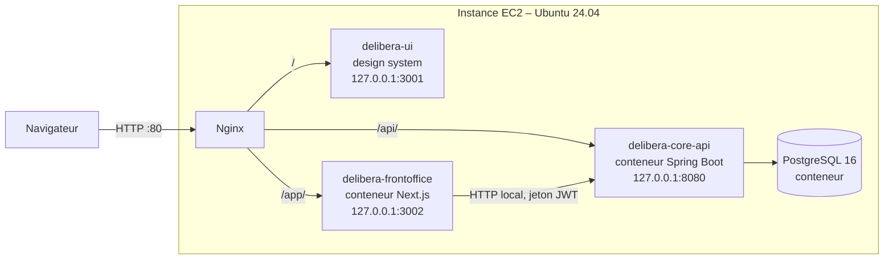
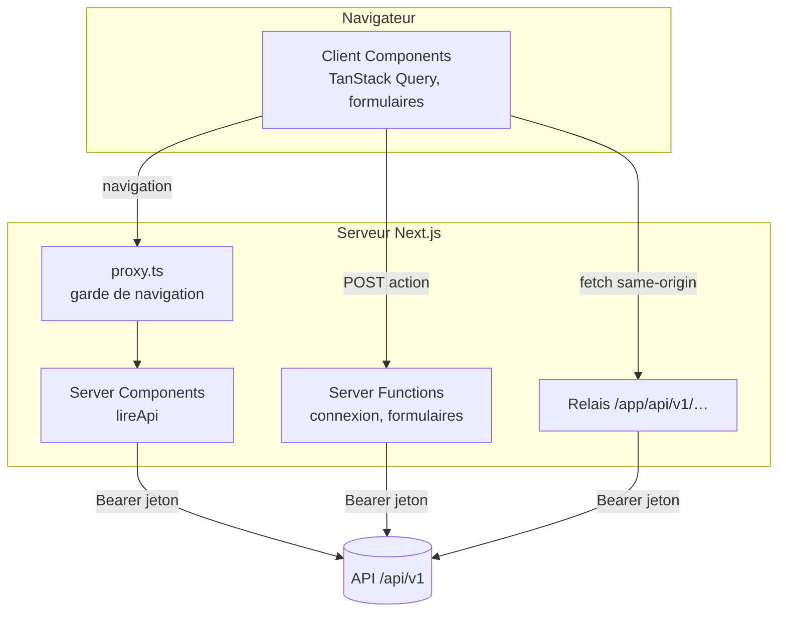
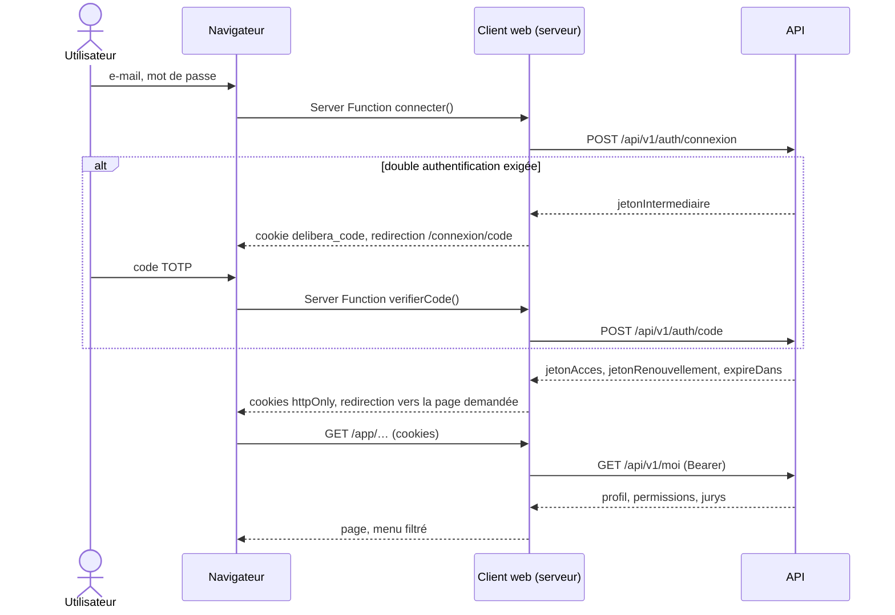
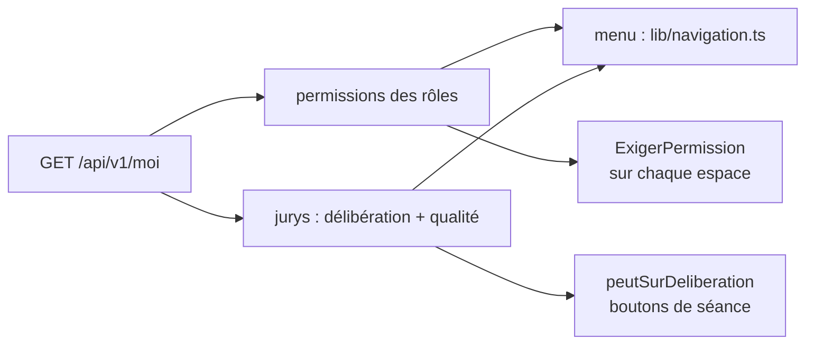
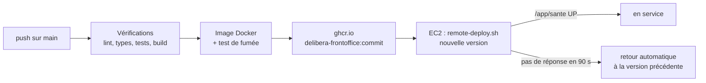

# Architecture du client web

Ce document décrit comment `delibera-frontoffice` s'insère dans la plateforme, comment il gère la session et comment il échange avec l'API. Les règles qui en découlent sont dans `AGENT.md` ; les choix sont justifiés dans `docs/decisions/`.

## 1. Place dans la plateforme

Le cahier de conception (§5.3) prévoit un serveur unique où Nginx sert le client web et relaie `/api` vers l'API Spring Boot. En attendant un nom de domaine, l'instance EC2 est jointe par son IP et sert trois applications :

- Le conteneur du client web utilise le **réseau de la machine** (`network_mode: host`) : il n'écoute que sur `127.0.0.1:3002` et joint l'API sur `127.0.0.1:8080`, publiée elle aussi sur la seule machine. Aucun port n'est ouvert sur Internet hormis 22 et 80.
- Le client web et l'API partagent la même origine (`http://<ip>`) : le navigateur n'a jamais besoin de CORS.

## 2. Rendu et données

| Mécanisme | Fichier | Utilisé pour |
| --- | --- | --- |
| `proxy.ts` | `src/proxy.ts` | Rediriger vers `/connexion` sans session, renouveler la session, écarter un utilisateur connecté de `/connexion` |
| Server Components | `src/modules/<m>/serveur.ts` (`lireApi`) | Données affichées au chargement d'une page |
| Server Functions | `src/modules/<m>/actions.ts` (`appelerApi`) | Authentification (`/auth/**`), formulaires de paramétrage |
| Relais | `src/app/api/[...chemin]/route.ts` | Appels du navigateur : listes filtrées, décisions en séance, téléversements, téléchargements |
| Client `api` | `src/lib/api/client.ts` | Accès au relais depuis les Client Components |

Avec **Cache Components** (décision 0002), la coquille et les parties statiques d'une page sont préparées à la construction, et tout ce qui dépend de la session arrive en flux sous des frontières `<Suspense>`. Nginx ne met pas ces réponses en mémoire tampon (`proxy_buffering off`), et Next.js envoie `X-Accel-Buffering: no`.

## 3. Session

Le cahier de conception (§6.1.7) fixe un jeton d'accès JWT de 15 min, renouvelé tant que l'utilisateur est actif, et une session close après 30 min d'inactivité. Le client web garde les jetons côté serveur (décision 0004) :

| Cookie | Contenu | Durée | Attributs |
| --- | --- | --- | --- |
| `delibera_acces` | Jeton d'accès JWT | Durée du jeton moins 30 s | `HttpOnly`, `SameSite=Strict`, `Path=/app`, `Secure` en HTTPS |
| `delibera_renouvellement` | Jeton de renouvellement | `DELIBERA_DUREE_RENOUVELLEMENT` (8 h par défaut) ; l'API reste seule juge | Idem |
| `delibera_code` | Jeton intermédiaire de la double authentification | 5 min | Idem |

### Connexion (CU00)

### Renouvellement

Le cookie d'accès expire 30 s avant le jeton. À la requête suivante :
- **navigation** : `proxy.ts` voit le cookie de renouvellement seul, appelle `POST /api/v1/auth/renouvellement`, pose les nouveaux cookies et transmet les nouveaux jetons à la page rendue dans la même requête ;
- **appel du navigateur** : le relais fait de même avant de transmettre l'appel ;
- en cas de refus (session révoquée, inactive depuis plus de 30 min) : cookies effacés, retour à `/connexion?suite=<page>`.

### Contrat attendu de l'API

Les routes `/auth/**` et `/moi` sont encore des **[Proposition]** du `SPEC.md` du module `securite` de l'API. Le contrat que le client attend est écrit dans `src/modules/securite/SPEC.md` (section « Contrat de l'API ») et typé dans `src/modules/securite/types.ts`. Tout écart lors de l'implémentation de l'API se reporte dans ces deux fichiers.

## 4. Relais `/app/api/v1`

Règles appliquées par `src/app/api/[...chemin]/route.ts` (testées dans `route.test.ts`) :

- seules les routes `v1/…` sont relayées, avec des segments simples (pas de `..`) ; **jamais `v1/auth/…`** ;
- une requête de modification (`POST`, `PUT`, `PATCH`, `DELETE`) doit venir du client web lui-même (`Sec-Fetch-Site: same-origin`, ou `Origin` identique à l'hôte), en plus de `SameSite=Strict` ;
- en-têtes transmis à l'API : `accept`, `content-type`, `accept-language`, `if-match`, `if-none-match`, `authorization` (ajouté) et l'IP du client ; jamais les cookies ;
- en-têtes renvoyés : `content-type`, `content-disposition`, `content-length`, `cache-control`, `etag`, `last-modified` ;
- corps transmis en flux dans les deux sens (fichiers d'import jusqu'à 10 Mo, PDF et XLSX) ;
- erreurs propres au client, au même format RFC 9457 que l'API : `SESSION_EXPIREE` (401), `ORIGINE_REFUSEE` (403), `API_INJOIGNABLE` (502).

## 5. Contrôle d'accès dans l'interface

- Le menu ne montre que les espaces permis ; chaque espace vérifie de nouveau (`ExigerPermission`) et affiche `AccesRefuse` sinon.
- Un membre du jury voit l'espace des délibérations même sans rôle, mais n'a ses droits (`DOSSIER_STATUER`, et pour le président `DELIB_VALIDER`, `PV_GENERER`, `REOUVERTURE_AUTORISER`) que sur **sa** délibération.
- L'API vérifie chaque requête (algorithme A8) : l'interface n'est qu'un confort.

## 6. Livraison

Fichiers : `Dockerfile`, `deploy/compose.prod.yaml`, `deploy/remote-deploy.sh`, `.github/workflows/ci-cd.yml`. Côté instance : `scripts/frontend-setup.sh` du dépôt `infra` (Nginx `/app/`, `delibera-front-compose`, configuration).
